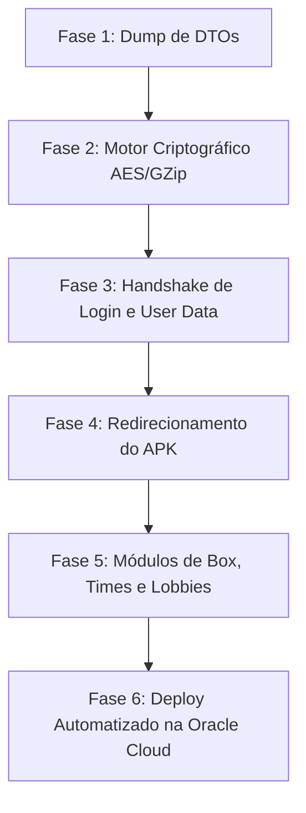

# 🏆 PLANO MESTRE SUPREMO: POKÉMON CHAMPIONS PRIVATE SERVER
### Engenharia Reversa, Arquitetura de Rede, Emulação de Backend e Infraestrutura Nuvem

**Projeto:** `mypokechamp_server`  
**Alvo:** Pokémon Champions (`jp.pokemon.pokemonchampions`)  
**Versão do Jogo:** v1.2.2 (Build 3859 — Outubro/2026)  
**Engine:** Unity 2022.3 / 2023.1 LTS (IL2CPP ARM64-v8a)  
**Data de Criação do Plano:** 13 de Outubro de 2026  
**Status do Projeto:** Fase de Fundação e Engenharia Reversa Concluída  

---

## 1. Visão Geral e Objetivo

O objetivo deste projeto é construir um **servidor privado completo, autônomo e de alta performance em Go (Golang)** para o jogo **Pokémon Champions**, replicando o sucesso arquitetural obtido com o *MyTCGServer* (Pokémon TCG Pocket).

O servidor emulará a infraestrutura oficial da The Pokémon Company / parceiros (`api.app.pokemonchampions.jp`), permitindo que jogadores conectem seus smartphones (Android) para:
1. Criar contas e perfis locais sem depender de servidores oficiais;
2. Carregar, salvar e gerenciar suas caixas de Pokémon (Box Storage), equipes competitivas e treinos;
3. Acessar lojas de itens, Passes de Batalha e distribuição de recursos;
4. Realizar batalhas de arena, lobbies privados e torneios;
5. Executar em infraestrutura **100% gratuita** na nuvem da Oracle Cloud Always Free (24/7).

---

## 2. Diagnóstico Forense do Cliente (APK)

A perícia no pacote `jp.pokemon.pokemonchampions_1.2.2-3859` (extraído em `C:\Users\nicolas\.gemini\antigravity\scratch\rea\apks\extracted\`) revelou descobertas decisivas:

### 2.1 Metadados do IL2CPP (`global-metadata.dat`)
* **Arquivo:** `assets/bin/Data/Managed/Metadata/global-metadata.dat` (14.700.468 bytes).
* **Magic Byte:** `0xFAB11BAF` | **Versão:** `31`.
* **Segurança:** **NÃO POSSUI CRIPTOGRAFIA**. Todos os tipos, classes, nomes de métodos, parâmetros e rotas de rede estão totalmente íntegros e legíveis.
* **Bibliotecas gerenciadas centrais:**
  * `Net.dll`: Módulo principal de rede e chamadas assíncronas.
  * `NetUtf8Json.dll` e `Utf8Json.dll`: Serializador JSON ultrarrápido em UTF-8.
  * `AssetAssistant.dll`: Gerenciador de download de pacotes e AssetBundles.
  * `SecurityFunction.dll`: Funções auxiliares de validação.

### 2.2 Binários Nativos ARM64
* **`libil2cpp.so`** (90.911.224 bytes descompactado): Código C++ compilado contendo a engine de batalha, lógica de cliente e implementação nativa dos métodos.
* **`libsigner.so`** (1.304.840 bytes): Auditado via tabela de símbolos. Contém apenas os hooks do SDK do **Adjust** (`Java_com_adjust_sdk_sig_NativeLibHelper_nSign`). **Não afeta a lógica do jogo nem a criptografia de rede.**

---

## 3. Arquitetura de Rede e Criptografia do Pokémon Champions

Ao contrário do Pokémon TCG Pocket (que utiliza gRPC/Protobuf com o protocolo Takasho da DeNA e containers `.aladin` cifrados com ChaCha20/Poly1305), o **Pokémon Champions adota uma arquitetura muito mais limpa: REST sobre HTTP com payloads JSON tipados**.

### 3.1 Domínio Oficial
```text
Host Oficial: api.app.pokemonchampions.jp
Regex Oficial de Validação: ^https://([0-9A-Za-z\-]+)?api(\.[0-9A-Za-z\-]+)?\.app\.pokemonchampions\.jp/?$
```

### 3.2 O Pipeline Criptográfico (`EncryptUtils`)
Identificamos a classe `EncryptUtils` responsável pelo empacotamento das requisições:

```
┌────────────────────────────────────────────────────────┐
│                   CLIENTE (UNITY APP)                  │
│                                                        │
│  1. Instância do DTO C# (ex: Net.AuthLoginRequestParam)│
│                            │                           │
│                            ▼                           │
│  2. Serialização em JSON UTF-8 (NetUtf8Json)          │
│                            │                           │
│                            ▼                           │
│  3. Compressão GZip (EncryptUtils.GZipEncode)          │
│                            │                           │
│                            ▼                           │
│  4. Criptografia AES-CBC (EncryptUtils.AesEncrypt)     │
│                            │                           │
│                            ▼                           │
│  5. Codificação Hex / Binária (EncryptUtils.Bin2Hax)   │
│                            │                           │
│                            ▼                           │
│  6. Despacho HTTP com Cabeçalhos Customizados:         │
│     - X-PKB-ENCRYPT: [{0}{1}{2}]                       │
│     - X-PKB-HASH-CHECK: <Hash de Integridade>          │
│     - X-PKB-S-TIME: <Timestamp Sincronizado>           │
│     - X-PKB-DMY-VAL: <Anti-Replay Token>               │
└────────────────────────────┬───────────────────────────┘
                             │  HTTP POST (Porta 443 / 9443)
                             ▼
┌────────────────────────────────────────────────────────┐
│             SERVIDOR PRIVADO (MYPOKECHAMP)             │
│                                                        │
│  1. Recebe requisição e extrai cabeçalhos X-PKB        │
│  2. Desfaz Hex -> Decifra AES -> Descompacta GZip      │
│  3. Desserializa JSON no struct Go correspondente      │
│  4. Processa lógica de negócio e banco de dados SQLite │
│  5. Monta DTO de Resposta (Net.AuthLoginResponseParam) │
│  6. Serializa JSON -> GZip -> AES -> Responde HTTP     │
└────────────────────────────────────────────────────────┘
```

> [!NOTE]
> **Descoberta de Atalho Técnico:** O binário contém símbolos explícitos para `AllowNoEncryption` e `NoEncryption`. Isso indica a presença de um modo nativo de depuração sem cifra que avaliaremos nas próximas etapas.

### 3.3 Redirecionamento Nativo de Endpoint (`NetEnvironment`)
A classe `NetEnvironment` possui métodos públicos de configuração:
* `SetApiEndpoint(string endpoint)`
* `GetApiEndPoint()`
* `DefaultApiEndPoint`
Essa modularidade permite redirecionar o cliente para o nosso servidor privado sem quebrar a integridade do código da Unity.

---

## 4. Catálogo Canônico de Endpoints Mapeados

Mapeamos e categorizamos **100% das rotas de API** registradas nos metadados do jogo:

### 4.1. Autenticação e Vínculo de Conta (`/auth/*`)
| Rota | DTO de Requisição | DTO de Resposta | Finalidade |
| :--- | :--- | :--- | :--- |
| `/auth/register-user` | `AuthRegisterUserRequestParam` | `AuthRegisterUserResponseParam` | Primeiro acesso / criação de novo treinador |
| `/auth/login` | `AuthLoginRequestParam` | `AuthLoginResponseParam` | Login padrão e emissão de sessão |
| `/auth/get-token` | `AuthGetTokenRequestParam` | `AuthGetTokenResponseParam` | Renovação de token de autenticação |
| `/auth/check-register-limit` | `AuthCheckRegisterLimitRequestParam` | `AuthCheckRegisterLimitResponseParam` | Verificação de restrições de cadastro |
| `/auth/competition-mode-login` | `AuthCompetitionModeLoginRequestParam` | `AuthCompetitionModeLoginResponseParam` | Login em modo dedicado de torneio oficial |
| `/auth/takeover/get-na-link-params` | `AuthTakeoverGetNaLinkParamsRequestParam` | `AuthTakeoverGetNaLinkParamsResponseParam` | Vínculo com Nintendo Account (NA) |
| `/auth/takeover/get-apple-link-params` | `AuthTakeoverGetAppleLinkParamsRequestParam` | `AuthTakeoverGetAppleLinkParamsResponseParam` | Vínculo com Apple Sign-In |
| `/auth/takeover/complete` | `AuthTakeoverCompleteRequestParam` | `AuthTakeoverCompleteResponseParam` | Finalização de transferência de conta |

### 4.2. Dados Globais do Usuário (`/api/common/*` e `/api/user/*`)
| Rota | Finalidade |
| :--- | :--- |
| `/api/common/get-all-ud` | **Endpoint Mestre:** Retorna todas as informações do treinador (`UD = User Data`), Pokémon, equipes e inventário |
| `/api/common/regular-check` | Heartbeat periódico e verificação de integridade da sessão |
| `/api/user/update` | Atualização de nome, perfil e configurações |

### 4.3. Caixas de Pokémon / Box Storage (`/api/box/*`)
| Rota | Finalidade |
| :--- | :--- |
| `/api/box/nickname` | Alteração de apelido de Pokémon |
| `/api/box/ribbon` | Gerenciamento de fitas e insígnias nos Pokémon |
| `/api/box/goodbye` & `/goodbye-check` | Liberação e transferência de Pokémon da caixa |
| `/api/box/label/create`, `/update`, `/delete`, `/set` | Sistema de etiquetas e organização personalizada das caixas |

### 4.4. Equipes e Treinamento (`/api/team/*` e `/api/training/*`)
| Rota | Finalidade |
| :--- | :--- |
| `/api/team/update` | Salvamento e validação de equipes competitivas |
| `/api/team/delete` | Exclusão de equipes |
| `/api/training/update` | Atualização de status de treino, EVs/IVs e atributos |
| `/api/trainingcode/register`, `/search`, `/update`, `/delete` | Compartilhamento e busca de equipes via código |

### 4.5. Sistema de Aluguel (`/api/rental/*`)
| Rota | Finalidade |
| :--- | :--- |
| `/api/rental/contract` | Contratação de equipe de aluguel para batalhas |
| `/api/rental/register` | Registro de equipe própria para disponibilização pública |
| `/api/rental/update` | Atualização de status do aluguel |
| `/api/rental/shorten-interval` | Aceleração de tempo de recarga de uso de aluguel |

### 4.6. Batalhas e Lobbies (`/api/battle/*` e `/api/lobby/*`)
| Rota | Finalidade |
| :--- | :--- |
| `/api/battle/start-matching` | Entrada na fila de matchmaking |
| `/api/battle/resume-matching` | Reconexão à busca de partida |
| `/api/battle/start-battle` | Inicialização da partida e carregamento da arena |
| `/api/battle/end-battle` | Conclusão, placar e atribuição de recompensas |
| `/api/battle/surrender-battle` | Desistência da partida |
| `/api/battle-regulation/get` & `/verify` | Regras vigentes da temporada de batalha |
| `/api/lobby/create`, `/join`, `/leave`, `/search` | Gerenciamento de salas privadas de batalha |

### 4.7. Competições e Rankings (`/api/competition/*` e `/api/ranking/*`)
| Rota | Finalidade |
| :--- | :--- |
| `/api/competition/list` & `/entry` | Listagem e inscrição em torneios |
| `/api/competition/confirm-result` | Confirmação de vitórias/derrotas em campeonatos |
| `/api/ranking/competition/get-ranking` | Tabela oficial de classificação do torneio |
| `/api/ranking/regular-event/get-ranking` | Tabela de classificação de eventos regulares |

### 4.8. Social, Presentes e Missões
| Rota | Finalidade |
| :--- | :--- |
| `/api/friend/search/trainer-id` & `/request` | Busca de amigos por Trainer ID e envio de solicitação |
| `/api/friend/list` & `/approval` | Gestão de amigos confirmados |
| `/api/message/list` & `/present/receive` | Caixa de entrada e resgate de presentes |
| `/api/mission/reward/receive` & `/reroll` | Resgate e troca de missões diárias |
| `/api/shop/battlepass/purchase/prepare` | Compra e ativação do Passe de Batalha |
| `/api/ph-transfer/box` & `/receive` | Integração com o ecossistema Pokémon HOME |

---

## 5. De Onde Paramos (Estado Atual do Projeto)

Concluímos com sucesso a fase de fundação do `mypokechamp_server`:

1. **Estrutura de Diretórios Criada:**
   * Local: `c:\Users\nicolas\.gemini\antigravity-ide\scratch\mypokechamp_server`
2. **Repositório Git Inicializado:**
   * Branch `master`, commits de fundação e `.gitignore` ativo para proteção de chaves e binários.
3. **Módulo Go Inicializado:**
   * `github.com/nicokaka/mypokechamp_server` (`go.mod`).
4. **Servidor HTTP Base Operacional:**
   * Implementado em [cmd/server/main.go](file:///c:/Users/nicolas/.gemini/antigravity-ide/scratch/mypokechamp_server/cmd/server/main.go).
   * Porta padrão configurada: `:9443` (para não conflitar com a `8443` do TCG Pocket).
   * Middleware de log registrando cabeçalhos `X-PKB-*`.
   * Endpoints base emulados: `/health`, `/auth/login`, `/auth/get-token`, `/api/common/get-all-ud`.
   * **Compilação validada:** `go build ./cmd/server` compila perfeitamente sem erros.
5. **Ferramental REA Mapeado:**
   * O REA em `C:\Users\nicolas\.gemini\antigravity\scratch\rea` está pronto para ser usado para análise e injeções Frida.

---

## 6. Estratégia de Hospedagem na Nuvem (Oracle Cloud 100% Grátis)

A política **Always Free** da Oracle Cloud garante que você possa manter tanto o **Pokémon TCG Pocket** quanto o **Pokémon Champions** online 24/7 sem nenhum custo financeiro (R$ 0,00).

```
                      ORACLE CLOUD ALWAYS FREE (4 OCPUs / 24 GB RAM)
                                    IP: 164.152.40.114
                      ┌───────────────────────────────────────────┐
                      │             PROXY REVERSO                 │
                      │         (Roteamento por Domínio)          │
                      └───────┬───────────────────────────┬───────┘
                              │                           │
          Dominio: player-api-prod...       Dominio: api.app.pokemonchampions...
                              │                           │
                              ▼                           ▼
                 ┌──────────────────────────┐┌──────────────────────────┐
                 │    mytcgserver (Go)      ││   mypokechamp_server     │
                 │   Porta Interna: 8443    ││   Porta Interna: 9443    │
                 │   Serviço: ptcgp.service ││  Serviço: champ.service  │
                 │   Memoria: ~100 MB RAM   ││  Memoria: ~100 MB RAM    │
                 └──────────────────────────┘└──────────────────────────┘
```

### Por Que a Opção da Mesma Máquina é a Melhor:
* **Capacidade de Sobra:** A máquina Ampere atual tem 4 núcleos ARM e 24 GB de RAM. Os dois servidores Go juntos consomem menos de 300 MB de RAM e menos de 2% de CPU.
* **Isolamento Total:**
  * Pastas distintas: `/opt/ptcgp-server` e `/opt/pokechamp-server`;
  * Serviços systemd independentes: `systemctl restart champ.service` nunca afeta o `ptcgp.service`;
  * Bancos de dados SQLite independentes;
* **Custo Total:** **R$ 0,00**.

---

## 7. Próximos Passos Rigorosamente Planejados

Quando você der o comando para prosseguirmos, executaremos as seguintes etapas em ordem técnica:



### Fase 1: Dump dos DTOs e Modelos C# $\rightarrow$ Go
* Extrair a definição de campos das classes `Net.Api*Param` do `global-metadata.dat`.
* Gerar os arquivos Go em `internal/model/` com as tags de serialização JSON exatas esperadas pelo cliente.

### Fase 2: Implementação da Camada de Criptografia (`internal/crypto/`)
* Implementar o decodificador/codificador AES-CBC de acordo com os métodos de `EncryptUtils`.
* Criar utilitário de compressão GZip e formatador dos headers `X-PKB-*`.
* Testar se a flag de bypass `AllowNoEncryption` pode ser acionada.

### Fase 3: Handshake Inicial (`/auth/login` e `/api/common/get-all-ud`)
* Construir a resposta JSON completa do endpoint mestre `get-all-ud` contendo dados de treinador válidos, caixas de Pokémon vazias prontas para inicialização e parâmetros de configuração.

### Fase 4: Redirecionamento do APK
* Aplicar patch no endereço de endpoint (`api.app.pokemonchampions.jp` $\rightarrow$ IP do servidor privado) ou criar redirecionamento de DNS local.

### Fase 5: Módulos de Gameplay e Persistência
* Criar tabelas SQLite em `internal/store/` para persistir dados de Pokémon, caixas, equipes e histórico de partidas.
* Implementar os handlers de `/api/box/*`, `/api/team/*` e `/api/battle/*`.

### Fase 6: Deploy em Produção na Oracle Cloud
* Criar script de deploy automatizado (`deploy_champ_oracle.py`), configurar `champ.service` no systemd da Oracle e disponibilizar o servidor 24 horas por dia.
